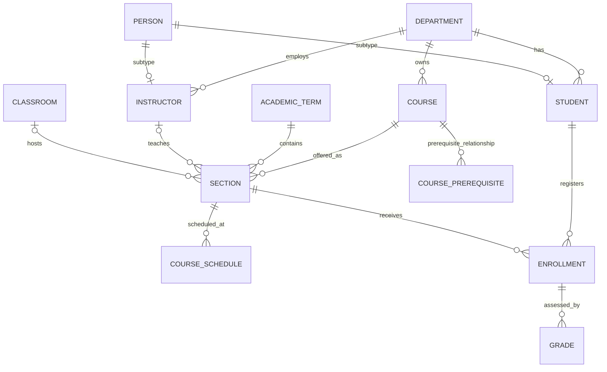

# ER/EER Model

## EER specialization
PERSON is the supertype. STUDENT and INSTRUCTOR are partial, potentially overlapping subtypes. A person may have neither subtype row or both. Each subtype has a unique person_id foreign key to PERSON. The database does not enforce total specialization or disjointness.

Rendered diagram sources should be kept in docs/diagrams/ in the full project package.